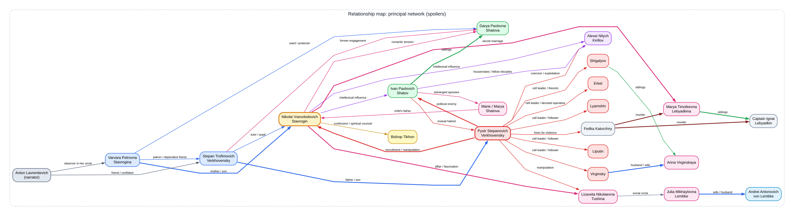

# *Demons* / *The Devils* / *The Possessed*

## Character guide and relationship map

**Author:** Fyodor Dostoevsky  
**Purpose:** A practical reference for remembering who the characters are, how they connect and why they matter.  
**Spoiler warning:** This guide includes major plot developments, deaths and revelations.

## How to use this guide

The novel is also published under the titles *The Devils* and *The Possessed*. Russian names appear in different transliterations across translations. This guide uses familiar English forms and records important variants where useful.

The diagram maps the principal network rather than every named townsperson. Relationship labels are deliberately functional: family, romantic, intellectual, political, social, spiritual or violent. Many relationships change over the course of the novel, so an edge describes a significant connection, not necessarily a stable or morally healthy one.

**Diagram reading key:[REDACTED_SECRET] blue = family, guardianship or institutional tie; pink = romantic or marital tie; purple = intellectual influence; red = political manipulation or conspiracy; dark red = violence; gold = spiritual counsel; grey = narrative or social connection; green = sibling or household tie.

## 1. The central architecture of the novel

The character network has three overlapping centres:

1. **Stepan Trofimovich** makes ideas socially attractive through eloquence, liberal self-image and cultivated talk.
2. **Nikolai Stavrogin** supplies charisma, moral vacancy and psychological force. Other characters project belief, desire or purpose onto him.
3. **Pyotr Verkhovensky** converts ideas and personal influence into organisation, manipulation and violence.

The younger characters then take different paths through Stavrogin’s influence. Shatov moves towards faith and national belonging; Kirillov turns the logic of absolute freedom towards suicide; Pyotr weaponises the same milieu politically. The resulting catastrophe is enabled not only by conspirators but also by respectable households, social vanity, weak authority and unresolved family relationships.

## 2. Primary character list

### Anton Lavrentievich G-v

**Also seen as:** Anton Lavrentievich, the chronicler or narrator.

**Who he is:** A young provincial gentleman and observer who narrates the events, often reconstructing scenes from testimony rather than witnessing everything directly.

**Key relationships:** Close friend and confidant of Stepan; present in Varvara’s social circle; an observer of the town’s political and personal breakdown.

**Why he matters:** He provides the novel’s filtering consciousness. His partial knowledge, social access and occasional uncertainty make the story feel like a community trying to understand a catastrophe after it has begun.

### Varvara Petrovna Stavrogina

**Who she is:** A wealthy landowner, widow and forceful provincial matriarch.

**Key relationships:** Mother of Nikolai; patron and long-standing companion of Stepan; guardian of Darya Shatova; friend of Praskovya; connected to the governor’s circle.

**Why she matters:** Varvara represents authority, patronage and the older social order, but she also helps create the conditions in which dependency, vanity and unspoken feelings flourish. Her household is the social hub through which many characters connect.

### Stepan Trofimovich Verkhovensky

**Who he is:** An ageing former academic, teacher, liberal intellectual and professional talker.

**Key relationships:** Father of Pyotr; former tutor to Nikolai; financially dependent on Varvara; former fiancé of Darya; friend and confidant of Anton.

**Why he matters:** Stepan embodies the idealistic, Western-influenced generation of the 1840s. His language and ideals are not identical to Pyotr’s revolutionary violence, but his self-dramatisation and lack of responsibility make him part of the generational background from which Pyotr emerges.

### Nikolai Vsevolodovich Stavrogin

**Also seen as:** Nicholas Stavrogin, Nikolay Stavrogin.

**Who he is:** A wealthy, charismatic former officer and the novel’s moral and psychological centre.

**Key relationships:** Son of Varvara; former pupil of Stepan; secret husband of Marya Lebyadkina; romantically entangled with Liza and Darya; intellectual influence on Shatov and Kirillov; subject of Pyotr’s attempted recruitment; recipient of Tikhon’s counsel.

**Why he matters:** Stavrogin possesses extraordinary force without a stable governing belief. He inspires others to pursue incompatible extremes but does not take responsibility for the consequences. His passivity is not harmless: his silence, concealment and refusal to commit allow other people to use his image as a source of authority.

### Pyotr Stepanovich Verkhovensky

**Also seen as:** Peter Stepanovich, Petr Verkhovensky.

**Who he is:** Stepan’s son and the organiser of the revolutionary conspiracy.

**Key relationships:** Son of Stepan; attempts to use Stavrogin as a symbolic leader; manipulates Liza and Julia; directs the conspiratorial cell; recruits or coerces Fedka, Kirillov and the cell members; targets Shatov.

**Why he matters:** Pyotr is the novel’s specialist in political technique. He turns grievance, vanity, fear and personal fascination into a system of leverage. His method is less a coherent political programme than a machinery for dependence, provocation and shared guilt.

### Ivan Pavlovich Shatov

**Also seen as:** Ivan Shatov, Chatov.

**Who he is:** A former revolutionary who has rejected the movement and seeks a spiritual and national foundation.

**Key relationships:** Brother of Darya; former disciple of Stavrogin; housemate and friend of Kirillov; estranged husband of Marie; enemy of Pyotr; father of Marie’s child, although the child is biologically Stavrogin’s.

**Why he matters:** Shatov is the counterpoint to Pyotr’s revolutionary nihilism. His convictions are passionate but not fully secure. His murder shows how a group can use accusations of betrayal to convert political disagreement into an act of binding violence.

### Darya Pavlovna Shatova

**Also seen as:** Dasha, Daria.

**Who she is:** Shatov’s sister and Varvara’s ward or companion.

**Key relationships:** Sister of Shatov; protected by Varvara; formerly engaged to Stepan; connected romantically and practically to Stavrogin.

**Why she matters:** Darya moves between the older household and the younger crisis. She is one of the few characters willing to confront Stavrogin with practical moral seriousness rather than simply worshipping, fearing or exploiting him.

### Alexei Nilych Kirillov

**Also seen as:** Alexei Kirillov, Aleksei Nilych Kirillov, Kirílloff.

**Who he is:** An engineer and philosophical radical who lives with Shatov.

**Key relationships:** Formerly influenced by Stavrogin; friend and housemate of Shatov; connected to Pyotr’s revolutionary society; exploited by Pyotr’s plan to use his suicide to conceal the group’s crimes.

**Why he matters:** Kirillov tries to prove absolute human freedom through the deliberate defeat of fear, culminating in suicide. His sincerity contrasts with Pyotr’s instrumental use of his idea. He shows how an abstract philosophical argument can become deadly when converted into a demand for exemplary action.

### Lizaveta Nikolaevna Tushina

**Also seen as:** Liza Tushina, Lizaveta Nikolaevna.

**Who she is:** Praskovya’s daughter, a socially prominent young woman with strong feelings and an unstable relationship to the town’s moral drama.

**Key relationships:** Daughter of Praskovya; engaged to Mavriky; in love with or fascinated by Stavrogin; drawn into Pyotr’s manipulation; connected to Julia’s social circle.

**Why she matters:** Liza is both an observer and participant in the fascination surrounding Stavrogin. Her movement from romantic fantasy towards recognition is followed by a fatal attempt to approach the scene of the Lebyadkin murders.

### Marya Timofeevna Lebyadkina

**Also seen as:** Maria Lebyadkina, Marya Lebyadkina, the lame woman or Khromonozhka.

**Who she is:** A disabled and mentally vulnerable woman, sister of Captain Lebyadkin and Stavrogin’s secret wife.

**Key relationships:** Secretly married to Stavrogin; sister of Ignat Lebyadkin; financially supported through Stavrogin; murdered by Fedka.

**Why she matters:** Marya embodies a vulnerable, childlike religious and moral sensibility that exposes Stavrogin’s secret and rejects the social fiction surrounding him. Her marriage is treated by others as a scandal or joke, but the consequences are real and lethal.

### Captain Ignat Timofeevich Lebyadkin

**Also seen as:** Ignat Lebyadkin, Captain Lebyadkin.

**Who he is:** Marya’s drunken brother, a failed officer and comic-poetic figure.

**Key relationships:** Brother of Marya; dependent on money associated with Stavrogin; targeted alongside Marya by Fedka.

**Why he matters:** Lebyadkin combines grotesque self-display with genuine vulnerability. His presence makes the hidden marriage impossible to keep contained and helps expose the violence behind Stavrogin’s private arrangements.

### Marie / Marya Shatova

**Also seen as:** Marie, Marya Shatova.

**Who she is:** Shatov’s estranged wife, who returns pregnant.

**Key relationships:** Estranged wife of Shatov; mother of the child fathered by Stavrogin; assisted by Arina during childbirth; dies with the child after Shatov’s murder.

**Why she matters:** Marie creates a fragile possibility of reconciliation and family life around Shatov. Her death intensifies the novel’s sense that private renewal is crushed by the conspirators’ political logic.

### Bishop Tikhon

**Who he is:** A monk and spiritual adviser whom Shatov recommends to Stavrogin.

**Key relationships:** Meets Stavrogin for his confession; offers spiritual interpretation and counsel rather than political manipulation.

**Why he matters:** Tikhon is one of the few people who sees Stavrogin’s inner condition without being seduced by his social image. The chapter containing the confession was censored in some editions, so readers should check which version they are using.

## 3. The conspiratorial cell and its associates

### Shigalyov

**Who he is:** A historian and theorist who develops a system of social reorganisation.

**Key relationships:** Member of Pyotr’s revolutionary circle; brother of Arina; refuses to participate directly in Shatov’s murder, although he does not prevent it.

**Why he matters:** Shigalyov’s system begins from unlimited freedom and arrives at unlimited despotism. He represents the danger of abstract social design that treats people as units in a system.

### Virginsky

**Who he is:** A member of the revolutionary circle, presented as more humane and morally troubled than some colleagues.

**Key relationships:** Husband of Arina; follower within Pyotr’s circle; voices reservations about killing Shatov but remains present and fails to stop it.

**Why he matters:** Virginsky illustrates the gap between private moral hesitation and public responsibility. Disapproval without resistance does not prevent complicity.

### Arina Virginskaya

**Also seen as:** Arina, Virginsky’s wife.

**Who she is:** A midwife and wife of Virginsky; in many character guides, Shigalyov’s sister.

**Key relationships:** Wife of Virginsky; sister of Shigalyov; assists Marie during childbirth; her account influences Virginsky’s understanding of Shatov’s intentions.

**Why she matters:** Arina provides practical care and ordinary moral perception within a group dominated by abstract language and political theatre.

### Sergei Vasilyevich Liputin

**Who he is:** A petty official and conspirator known for gossip, resentment and atheistic radicalism.

**Key relationships:** Member of Pyotr’s cell; participates in Shatov’s murder; later attempts to escape and is arrested.

**Why he matters:** Liputin shows how a movement can recruit through envy, status anxiety and the pleasure of possessing secret knowledge.

### Lyamshin

**Who he is:** A postal official, pianist, mimic and prankster.

**Key relationships:** Member of the conspiratorial circle; participates in Shatov’s murder; breaks down afterwards and confesses.

**Why he matters:** His theatricality mirrors the novel’s concern with performance. The jester who treats politics as play encounters the irreversible consequences of violence.

### Erkel

**Who he is:** A young artillery ensign and devoted follower.

**Key relationships:** Fanatically loyal to Pyotr; helps bring Shatov to the murder site; participates without the hesitation shown by Virginsky.

**Why he matters:** Erkel represents obedience stripped of reflection. He is important for understanding how movements survive through people who convert loyalty into a substitute for judgement.

### Tolkachenko

**Who he is:** An associate of the revolutionary group with knowledge of criminals and the underworld.

**Key relationships:** Connected to Pyotr’s circle and its interest in using criminal elements.

**Why he matters:** He illustrates the conspirators’ attempt to widen political agitation into a broader ecology of disorder.

### Fedka Katorzhny

**Also seen as:** Fedka the Convict.

**Who he is:** A former convict and former serf associated with Stepan’s past.

**Key relationships:** Used by Pyotr; murders Marya and Ignat Lebyadkin and a servant; connected indirectly to Stepan through the history of serfdom and punishment.

**Why he matters:** Fedka is the point at which political manipulation becomes direct criminal violence. Pyotr treats him as an instrument, but the violence also exposes older social brutality beneath the conspirators’ modern language.

## 4. The governor’s circle and provincial society

### Andrei Antonovich von Lembke

**Also seen as:** Andrei von Lembke, the governor.

**Who he is:** The conscientious but ineffective provincial governor.

**Key relationships:** Husband of Julia; targeted and destabilised by Pyotr; works with officials such as Blum.

**Why he matters:** Lembke represents formal authority unable to recognise or respond to a threat that operates through social relationships, rumour and staged disorder.

### Julia Mikhaylovna von Lembke

**Also seen as:** Yuliya Mikhaylovna.

**Who she is:** The governor’s socially ambitious wife.

**Key relationships:** Wife of Lembke; cultivates Pyotr and the revolutionary circle under the illusion that she can use or contain them; connected to Liza’s social world.

**Why she matters:** Julia’s fascination with radical fashion and political theatre allows Pyotr access to respectable society. Her attempt to manage subversion becomes one of its enabling channels.

### Semyon Yegorovich Karmazinov

**Also seen as:** Karmazinov.

**Who he is:** An ageing, vain and fashionable writer.

**Key relationships:** Part of the liberal and literary establishment; interacts with Pyotr and the governor’s circle; commonly read as a satirical portrait of Ivan Turgenev.

**Why he matters:** Karmazinov represents cultural prestige detached from moral seriousness. His self-presentation helps the conspirators borrow legitimacy from the establishment they despise.

### Praskovya Ivanovna Drozdova

**Also seen as:** Praskovya.

**Who she is:** Liza’s mother and an old friend of Varvara.

**Key relationships:** Mother of Liza; friend and occasional rival of Varvara; connected to the provincial social network.

**Why she matters:** Praskovya helps establish the social web through which personal histories, rumours and marriage prospects circulate.

### Mavriky Nikolaevich

**Also seen as:** Maurice.

**Who he is:** A captain and Liza’s fiancé or intended husband.

**Key relationships:** Engaged to Liza; accompanies her during the final movement towards the Lebyadkin house.

**Why he matters:** Mavriky is a comparatively ordinary social and romantic alternative to Stavrogin’s destructive fascination. His presence also makes Liza’s choices and isolation visible.

### Gaganov

**Who he is:** A provincial gentleman whose family has a history of conflict with Stavrogin.

**Key relationships:** Personal adversary of Nikolai; linked to Stavrogin’s earlier public provocations.

**Why he matters:** Gaganov helps establish Stavrogin’s history of humiliation, duelling culture and aristocratic impunity.

### Blum

**Who he is:** An official in the governor’s office.

**Key relationships:** Works under or receives patronage from Lembke; searches Stepan’s house and is later criticised for doing so.

**Why he matters:** Blum illustrates bureaucratic action without strategic understanding. The official apparatus can intrude on the wrong targets while missing the central conspiracy.

### Sofya Matveyevna

**Also seen as:** Sofya, the book peddler.

**Who she is:** A travelling book seller who encounters Stepan after he leaves the town.

**Key relationships:** Cares for Stepan when he becomes ill; later receives Varvara’s protection.

**Why she matters:** Sofya offers a modest counterpoint to the novel’s grand ideological performances: practical kindness, religious feeling and human connection outside elite self-dramatisation.

### Aleksey Yegorych

**Also seen as:** Alexei Yegorych.

**Who he is:** Varvara’s butler.

**Key relationships:** Serves Varvara and the Stavrogin household.

**Why he matters:** He is a minor but useful anchor for the household structure and the practical world beneath its intrigues.

## 5. Relationship tracker

| Relationship | Type | Why it matters |
|---|---|---|
| Varvara → Nikolai | Mother and son | The central family tie around which patronage, secrecy and expectation accumulate. |
| Varvara → Stepan | Patron and dependent friend | Shows the older generation’s intimacy, dependency and failure of responsibility. |
| Stepan → Pyotr | Father and son | Links liberal idealism to revolutionary manipulation through a damaged generational relationship. |
| Stepan → Nikolai | Tutor and pupil | Stepan helps shape the intellectual atmosphere from which Stavrogin emerges. |
| Nikolai → Shatov | Intellectual influence | Stavrogin awakens an intense but unstable movement towards belief and national identity. |
| Nikolai → Kirillov | Intellectual influence | Stavrogin’s influence feeds Kirillov’s opposing interpretation of freedom and unbelief. |
| Pyotr → Nikolai | Recruitment and manipulation | Pyotr wants Stavrogin’s charisma as a legitimising centre for his organisation. |
| Pyotr → Shatov | Political enmity | Shatov’s defection makes him a threat to the group’s cohesion and secrecy. |
| Pyotr → Kirillov | Exploitation | Pyotr turns Kirillov’s planned suicide into a device for concealing the conspiracy. |
| Nikolai → Marya | Secret marriage | The hidden marriage exposes the gap between Stavrogin’s private acts and public identity. |
| Nikolai → Liza | Romantic fascination | Liza’s attraction reveals the destructive power of Stavrogin’s image. |
| Shatov ↔ Marie | Estranged marriage | Their attempted reconnection creates a fragile alternative to ideological violence. |
| Marie → Nikolai | Child’s paternity | The child links Stavrogin’s hidden sexual history to Shatov’s domestic life. |
| Marya ↔ Ignat | Siblings | Their vulnerability and dependence become targets of the conspiracy. |
| Pyotr → Fedka | Political use of criminal violence | Shows the transition from agitation and manipulation to murder. |
| Julia ↔ Lembke | Marriage and public authority | Their household becomes a route through which Pyotr enters official society. |
| Shigalyov ↔ Arina | Siblings | Contrasts abstract social theory with practical care and moral perception. |
| Virginsky ↔ Arina | Marriage | Virginsky’s hesitation is tested against Arina’s practical knowledge of Shatov’s situation. |
| Anton → Stepan | Narrator and confidant | Gives the reader an interpretive route into the older generation and the town’s social world. |
| Stavrogin → Tikhon | Confession and spiritual counsel | Provides the novel’s clearest attempt to interpret Stavrogin’s guilt and possibility of repentance. |

## 6. Name and translation guide

| Common form here | Variants likely to appear |
|---|---|
| Demons | *The Devils*, *The Possessed*, *Besy* |
| Nikolai Stavrogin | Nikolay Stavrogin, Nicholas Stavrogin |
| Pyotr Verkhovensky | Peter Verkhovensky, Petr Verkhovensky |
| Stepan Verkhovensky | Stephan Verkhovensky, Stepan Trofimovich |
| Ivan Shatov | Chatov, Ivan Pavlovich Shatov |
| Alexei Kirillov | Aleksei Kirillov, Kirílloff, Kirilloff |
| Marya Lebyadkina | Maria Lebyadkina, Marya Timofeevna, Khromonozhka |
| Ignat Lebyadkin | Captain Lebyadkin, Lebjadkin |
| Darya Shatova | Daria, Dasha, Darya Pavlovna |
| Lizaveta Tushina | Liza, Lise, Lizaveta Nikolaevna |
| Marie Shatova | Marya Shatova, Marie |
| Julia von Lembke | Yuliya Mikhaylovna |
| Mavriky | Maurice |

## 7. Critical reading notes

- Do not reduce the novel to a simple diagram in which one villain causes everything. Pyotr is the most active organiser, but he succeeds through existing social weaknesses and the passivity or vanity of others.
- Do not treat Stavrogin as a conventional protagonist. He is a centre of projection: the plot repeatedly shows what other people make of his silence, beauty, wealth and apparent freedom.
- Distinguish ideas from their carriers. Stepan, Stavrogin, Pyotr, Shatov, Kirillov and Shigalyov do not represent identical ideologies; they embody different ways that ideas become personality, social influence or political action.
- Track the difference between private hesitation and public responsibility. Virginsky’s doubts, Shigalyov’s refusal to participate directly and Lyamshin’s later breakdown do not undo their relationship to the group’s violence.
- Check the edition. The Stavrogin confession chapter, often titled “At Tikhon’s”, was censored or omitted in some historical editions and is essential to understanding the relationship between Stavrogin, Tikhon and the novel’s moral psychology.

## 8. Sources and verification note

This guide was checked against the novel’s publication and character overview, multiple character references and a searchable public-domain text. Secondary sources can differ in transliteration, the spelling of minor names and the classification of some family connections. Where a detail is translation-sensitive or interpretive, the guide flags the variation rather than presenting one spelling as universal.

- [Demons, publication and character overview](https://en.wikipedia.org/wiki/Demons_(Dostoevsky_novel))
- [Dostoevsky’s *Demons*: character guide and maps](https://www.davidlapadat.com/post/dostoevsky-demons-character-guide)
- [LitCharts character reference](https://www.litcharts.com/lit/demons/characters)
- [GradeSaver character list](https://www.gradesaver.com/demons/study-guide/character-list)
- [Project Gutenberg public-domain text](https://www.gutenberg.org/files/61906/61906-h/61906-h.htm)

**Note:** This is a study aid and relationship tracker, not a substitute for the novel or the notes in a specific translation.
